# Mafia: The Underground Society

A cinematic, real-time multiplayer Mafia party game. Players are dealt secret roles, scheme in private channels at night, argue their case by day, and vote to unmask the killers among them. Built with React, Express, Socket.io and PostgreSQL.

**Live demo:** [mafia-game-opal.vercel.app](https://mafia-game-opal.vercel.app)


## Contents

- [Overview](#overview)
- [Roles](#roles)
- [Features](#features)
- [Screenshots](#screenshots)
- [Architecture](#architecture)
- [Tech stack](#tech-stack)
- [Getting started](#getting-started)
- [Deployment](#deployment)
- [How to play](#how-to-play)
- [License](#license)

## Overview

Mafia: The Underground Society is a social deduction game for 4 to 10 players. A hidden Mafia eliminates one player every night, while the rest of the town has to work out who they are through discussion and voting before it is too late. The game runs entirely in the browser: a narrator announces every phase, the server keeps everyone in sync in real time, and games survive network drops and even server restarts.

## Roles

| | Role | Team | Ability |
|:---:|---|---|---|
|  | **Mafia** | Mafia | Chooses one player to eliminate each night. In games of 7+ there are two Mafia who know each other and coordinate on a private channel. Wins when the Mafia equal or outnumber everyone else. |
|  | **Medic** | Town | Protects one player (themselves included) from the Mafia each night. |
|  | **Detective** | Town | Optional, for games of 6+. Investigates one player each night and privately learns whether they are Mafia. The answer is final and only the Detective sees it. |
| 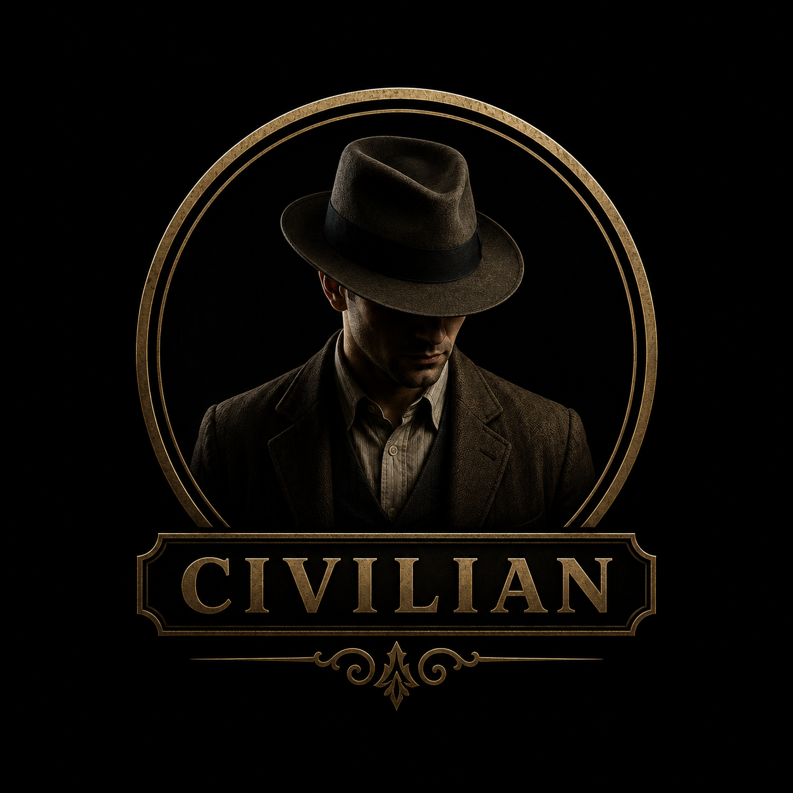 | **Civilian** | Town | No night action. Uses discussion, voting patterns and instinct to find the Mafia. The town wins when every Mafia member is eliminated. |

## Features

**Gameplay**
- Full night/day cycle: Mafia turn, Medic turn, optional Detective turn, discussion, voting and verdict.
- Host-controlled settings: discussion and voting timers, anonymous or public votes, optional role reveal on death, and the Detective toggle.
- Smarter voting: skip votes, ties spare everyone, and the ballot closes as soon as every living player has voted. With public votes, everyone sees who voted for whom.
- Private channels: a Mafia-only line at night and a graveyard chat where eliminated players can talk to each other.
- Browser text-to-speech narrator that announces each phase, with mute and autoplay handling.

**Players and progression**
- Accounts with email and password or Google sign-in.
- XP for every finished game, levels, and ranks from Street Rat to Don.
- A leaderboard of the top players.
- "Dossier" profile page: avatar, codename, stats per role, and permanent account deletion.

**Reliability and security**
- Server-authoritative game state; roles and private messages are only ever sent to the players allowed to see them.
- Game connections are authenticated with the player's session, so identities cannot be spoofed.
- Seamless reconnects: a dropped connection or page reload restores the phase, role, timer, chat, votes and XP card.
- Restart-proof games: room state is persisted to Postgres, so a deploy or crash only causes a brief reconnect.
- Hosts can remove players from the lobby; the host role passes on automatically if the host disconnects.

## Screenshots

| | |
|:---:|:---:|
| 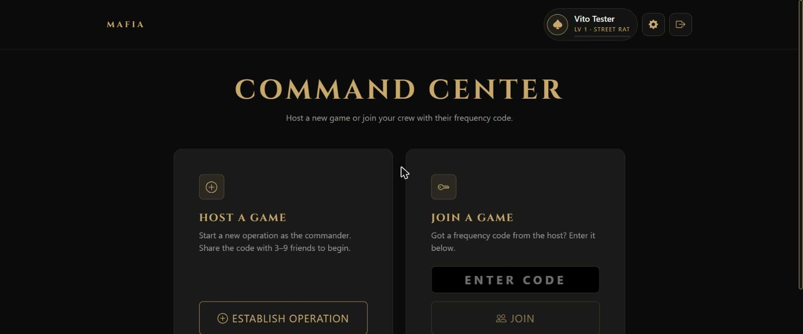 **Command Center** | 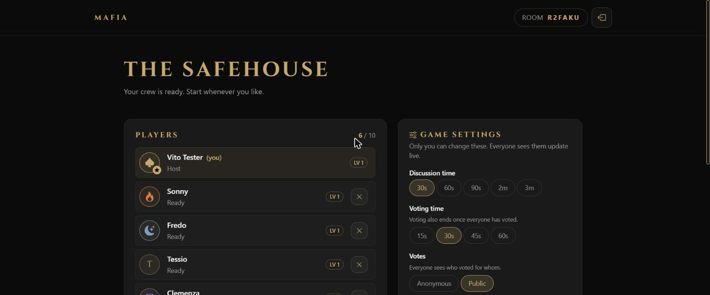 **Lobby and host settings** |
| 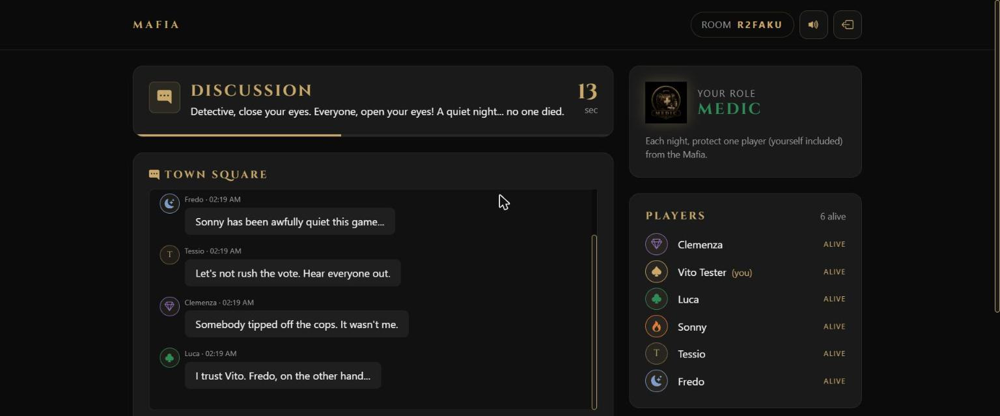 **Discussion** | 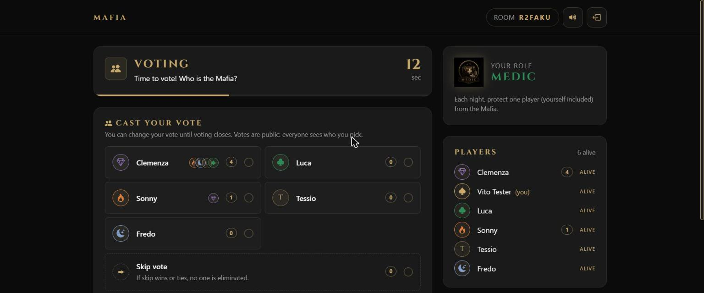 **Public voting** |
| 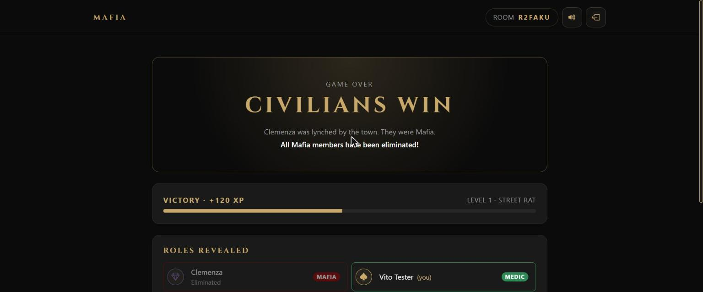 **Game over and XP** | 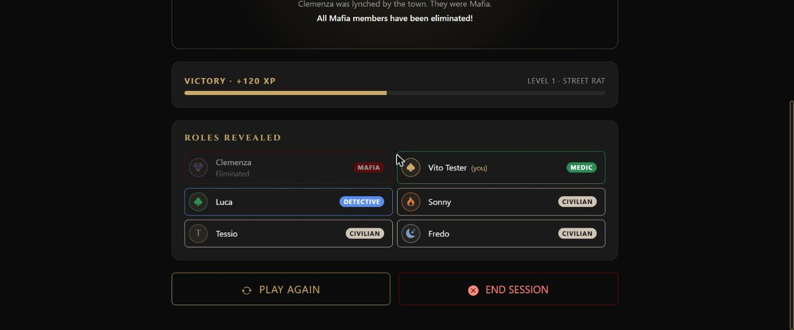 **Roles revealed** |
| 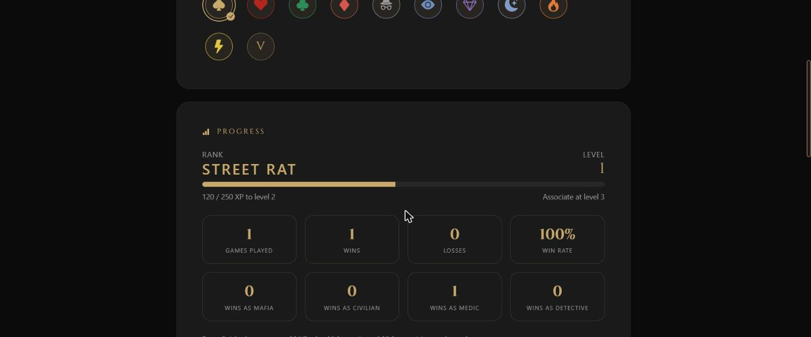 **Dossier and progress** | 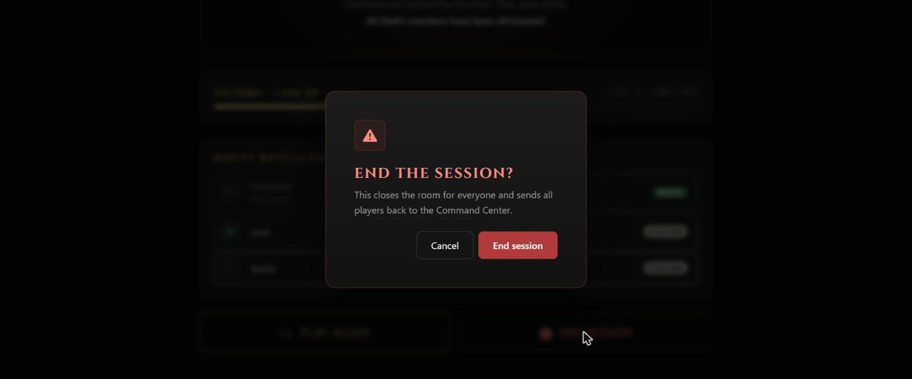 **Confirmation dialogs** |

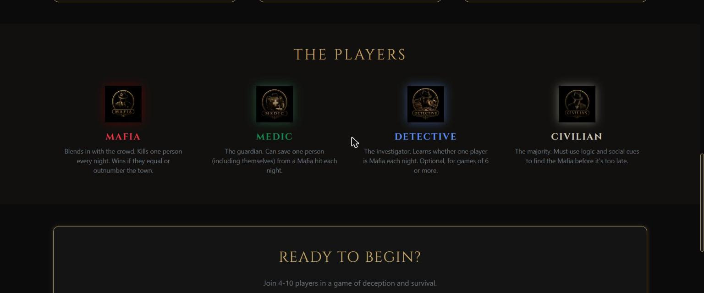

## Architecture

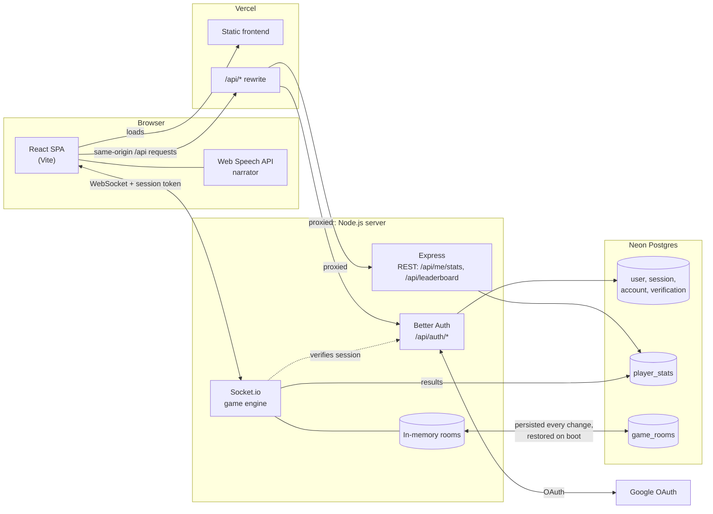

- **Same-origin auth.** The browser only ever calls `/api/*` on the frontend's own domain. Vercel (or the Vite dev server locally) proxies those requests to the backend, so login cookies stay first-party and the Google callback lands on the frontend domain.
- **Authenticated sockets.** The game connects to the backend directly over WebSocket and proves who the player is with their session token on every connection. Event payloads never decide identity.
- **Server-authoritative engine.** All game logic and timers run on the server. Clients render state and send intents (pick a target, vote, chat), which the server validates.
- **Persistence.** Rooms live in memory for speed and are mirrored to the `game_rooms` table after every change. On boot the server restores its rooms and gives players a grace period to reconnect before the interrupted phase continues.

### Game loop

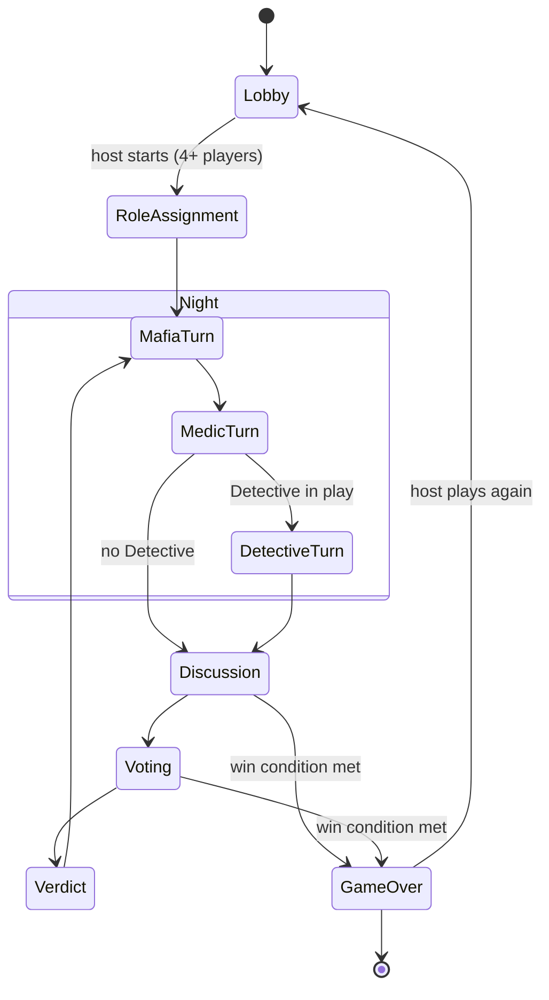

## Tech stack

| Layer | Technology |
|---|---|
| Frontend | React 19, Vite, Bootstrap 5, Framer Motion, React Bootstrap Icons, Socket.io client |
| Backend | Node.js, Express 5, Socket.io |
| Auth | Better Auth (email and password, Google OAuth, bearer tokens for sockets) |
| Database | Neon (serverless PostgreSQL) via `pg` |
| Narrator | Web Speech API |
| Hosting | Vercel (frontend), Render (backend) |

## Getting started

### Prerequisites

- Node.js 18 or newer
- A [Neon](https://neon.tech) Postgres project

### 1. Clone the repository

```bash
git clone https://github.com/TeekayVuyisile/mafia-game.git
cd mafia-game
```

### 2. Backend

```bash
cd backend
npm install
cp .env.example .env    # then fill in the values below
npm run migrate         # creates the auth, player_stats and game_rooms tables (safe to re-run)
npm run dev             # auto-restarting dev server; use `npm start` in production
```

`backend/.env`:

```env
PORT=5000
DATABASE_URL=postgresql://...neon.tech/neondb?sslmode=verify-full   # Neon > Connect (pooled)
BETTER_AUTH_SECRET=<random 32+ characters>
BETTER_AUTH_URL=http://localhost:5173   # the FRONTEND url
GOOGLE_CLIENT_ID=                       # optional
GOOGLE_CLIENT_SECRET=                   # optional
```

### 3. Frontend

```bash
cd ../frontend
npm install
npm run dev
```

Optional `frontend/.env` (defaults shown):

```env
VITE_SOCKET_URL=http://localhost:5000
VITE_API_PROXY_TARGET=http://localhost:5000
```

Open http://localhost:5173. Other useful commands: `npm run lint` and `npm run build` in `frontend/`.

## Deployment

### Backend on Render

1. Create a **Web Service** from the repository with root directory `backend`, build command `npm install` and start command `npm start`.
2. Set the environment variables `DATABASE_URL`, `BETTER_AUTH_SECRET`, `BETTER_AUTH_URL` (your frontend URL, for example `https://mafia-game-opal.vercel.app`) and, for Google sign-in, `GOOGLE_CLIENT_ID` and `GOOGLE_CLIENT_SECRET`.
3. Run `npm run migrate` once against the production database.

### Frontend on Vercel

1. Import the repository with the **Vite** preset and root directory `frontend`.
2. Set `VITE_SOCKET_URL` to the Render backend URL.
3. Update the backend URL in `frontend/vercel.json`, which rewrites `/api/*` to the backend.

### Google sign-in (optional)

Create an OAuth client in Google Cloud Console with the redirect URI `<BETTER_AUTH_URL>/api/auth/callback/google` (plus `http://localhost:5173/api/auth/callback/google` for local development). Publish the consent screen so any Google account can sign in; `frontend/public/privacy.html` and `terms.html` provide the required policy pages.

## How to play

1. **Establish an operation.** One player creates a room and shares its six-character code.
2. **Gather the crew.** Four to ten players join with the code. The host picks the game settings.
3. **Night falls.** The Mafia choose a target, the Medic chooses someone to protect, and in larger games the Detective investigates a suspect.
4. **Day breaks.** The night's casualty is announced and the town discusses who to trust.
5. **The trial.** Everyone votes. The player with the most votes is eliminated; a skip or a tie spares everyone.
6. **Victory.** The town wins when every Mafia member is gone. The Mafia win when they equal or outnumber everyone else.

## License

Copyright 2026 Teekay Vuyisile.

Licensed under the [Apache License, Version 2.0](LICENSE). You may use, modify and share this project, but any copy or derivative work must keep the copyright notice, include the [NOTICE](NOTICE) file crediting the original author, and state any changes made. The role artwork in `frontend/public` is part of this project and covered by the same terms.
